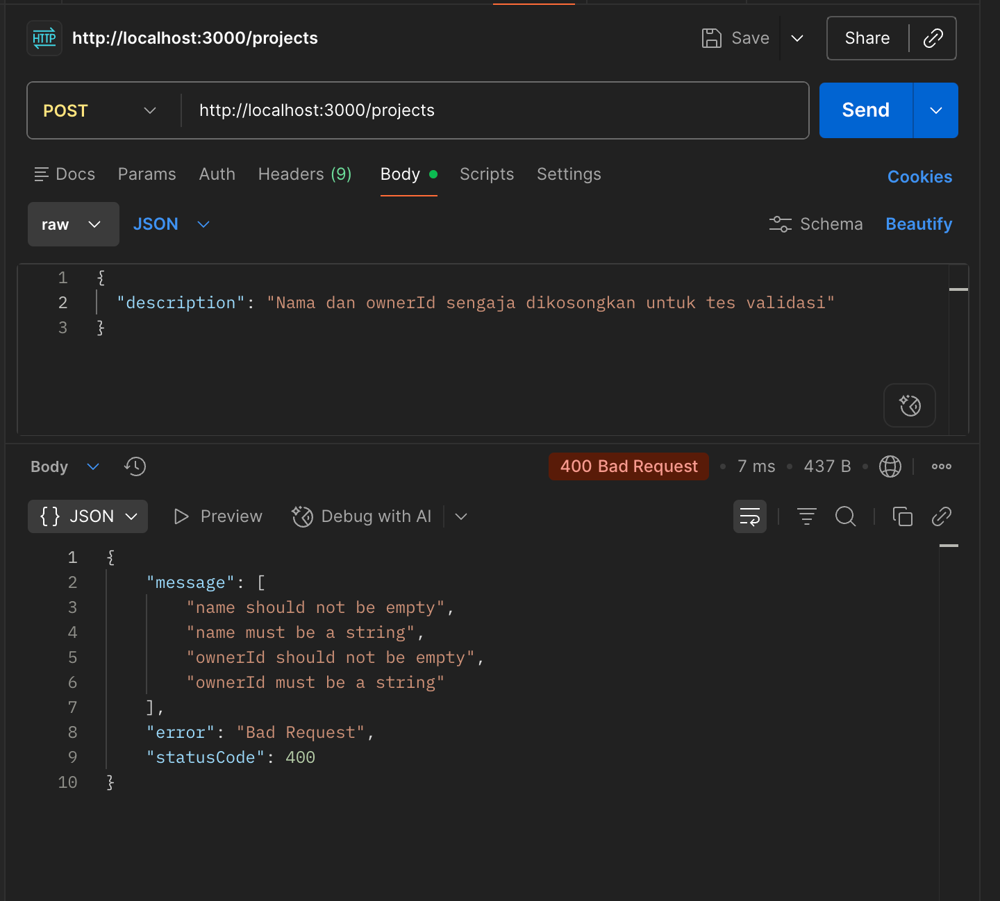
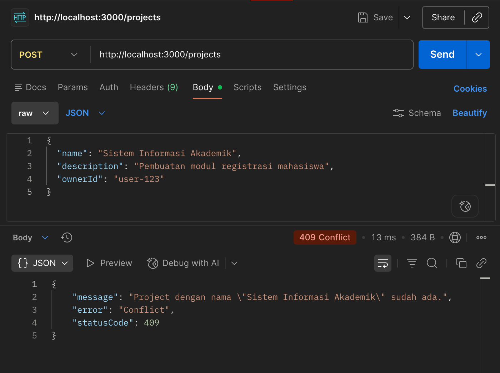
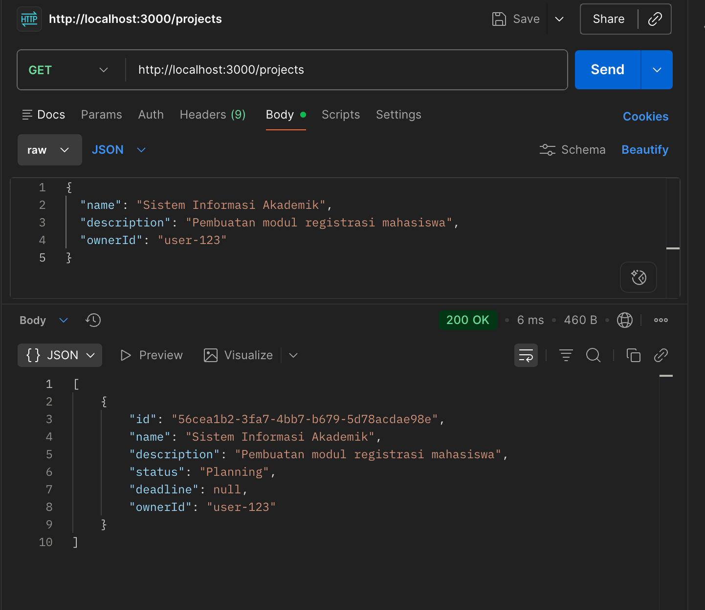
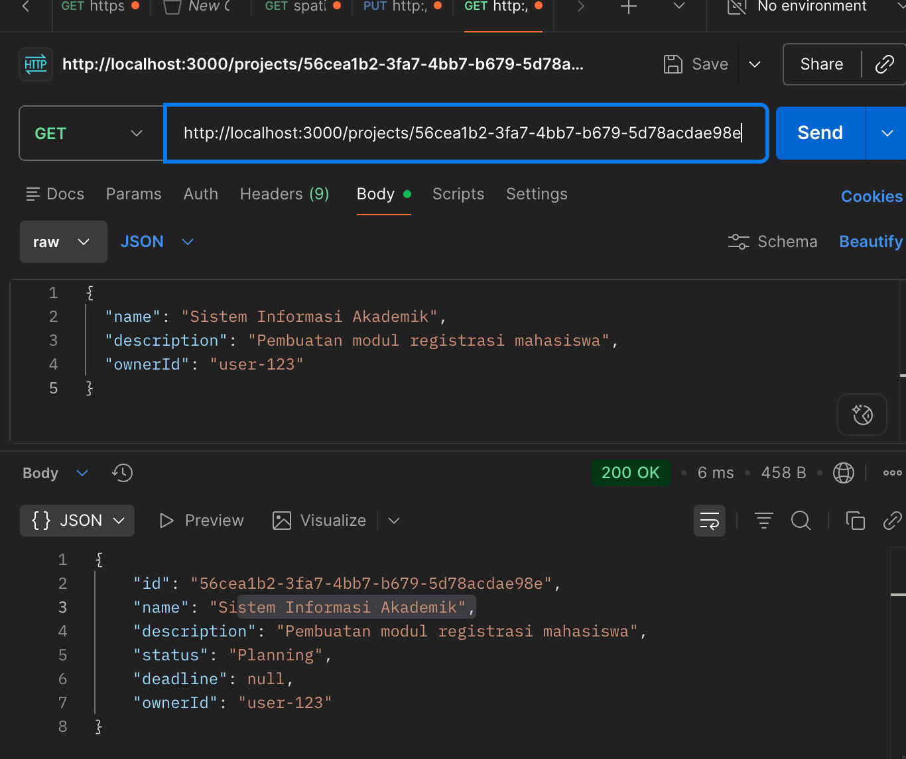
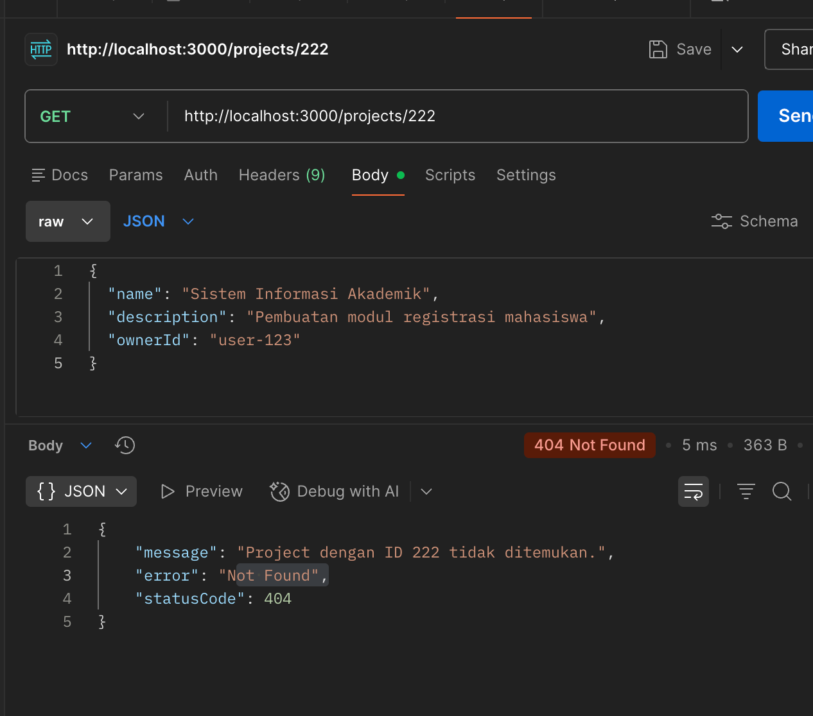
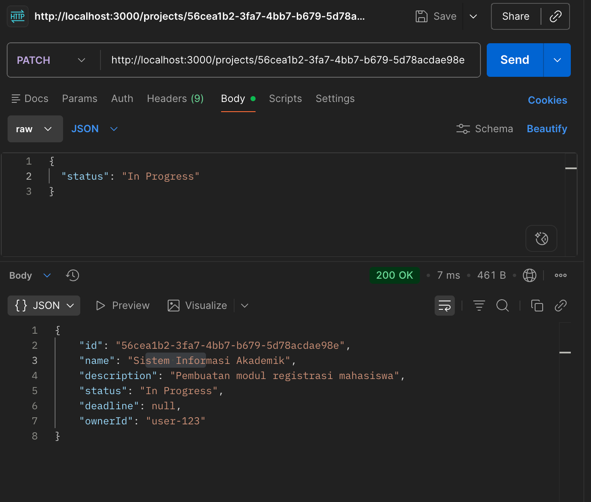

# GEMILANG (Gerbang Manajemen dan Integrasi Langkah Kerja)

**Tugas 9 – Pemrograman Web: NestJS Dasar + Struktur MVC**

GEMILANG merupakan aplikasi **Project Management System** berbasis web yang dirancang untuk membantu tim dalam mengelola proyek dan pekerjaan melalui satu platform terpusat.

Repository ini berisi implementasi backend menggunakan **NestJS** dengan pendekatan arsitektur MVC (Model-View-Controller) untuk mengelola entitas `Project`. Backend menyediakan REST API yang mendukung operasi CRUD, validasi data, serta penanganan error.

## Teknologi yang Digunakan

- **Backend:** NestJS
- **Programming Language:** TypeScript
- **Runtime:** Node.js
- **Validation:** class-validator, class-transformer
- **API Architecture:** REST API
- **HTTP Client:** Postman / REST Client
- **Frontend Integration:** React
- **Data Storage:** In-memory (sementara)

## Fitur Implementasi Backend

1. **Project Management:** Mengelola data proyek yang terdiri dari ID, nama, deskripsi, status, deadline, dan owner ID.
2. **Create Project:** Menambahkan proyek baru melalui HTTP POST.
3. **Read Project:** Mengambil seluruh data proyek maupun berdasarkan ID melalui HTTP GET.
4. **Update Project:** Memperbarui informasi proyek melalui HTTP PATCH.
5. **Delete Project:** Menghapus data proyek melalui HTTP DELETE.
6. **Data Validation:** Memvalidasi input menggunakan DTO dan `class-validator`.
7. **Exception Handling:** Menangani kesalahan menggunakan `NotFoundException`, `ConflictException`, dan `BadRequestException`.
8. **Frontend Integration:** Menghubungkan REST API dengan frontend React.

## Struktur Folder

```text
gemilang-be/
├── assets/
│   └── week-10/
│       ├── satu.png
│       ├── dua.png
│       ├── tiga.png
│       ├── empat.png
│       ├── lima.png
│       ├── enam.png
│       ├── tujuh.png
│       └── delapan.png
│
├── src/
│   ├── projects/
│   │   ├── dto/
│   │   │   ├── create-project.dto.ts
│   │   │   └── update-project.dto.ts
│   │   ├── entities/
│   │   ├── projects.controller.spec.ts
│   │   ├── projects.controller.ts
│   │   ├── projects.module.ts
│   │   ├── projects.service.spec.ts
│   │   └── projects.service.ts
│   │
│   ├── app.controller.ts
│   ├── app.controller.spec.ts
│   ├── app.module.ts
│   ├── app.service.ts
│   └── main.ts
│
├── test/
├── .gitignore
├── nest-cli.json
├── package.json
├── package-lock.json
└── tsconfig.json
```

## Cara Menjalankan Aplikasi

### 1. Clone Repository

```bash
git clone <URL_REPOSITORY>
```

Masuk ke direktori project:

```bash
cd gemilang-be
```

### 2. Install Dependencies

```bash
npm install
```

### 3. Jalankan Development Server

```bash
npm run start:dev
```

### 4. Akses REST API

Setelah server berhasil dijalankan, API dapat diakses melalui:

```text
http://localhost:3000/projects
```

Pastikan server berjalan sebelum melakukan pengujian menggunakan Postman atau REST Client.

---

## Dokumentasi REST API

Base URL:

```text
http://localhost:3000
```

| Method | Endpoint | Deskripsi |
|---|---|---|
| POST | `/projects` | Menambahkan proyek baru |
| GET | `/projects` | Mengambil seluruh proyek |
| GET | `/projects/:id` | Mengambil proyek berdasarkan ID |
| PATCH | `/projects/:id` | Memperbarui data proyek |
| DELETE | `/projects/:id` | Menghapus proyek berdasarkan ID |

### Format Data Project

Contoh struktur JSON data proyek:

```json
{
  "id": "56cea1b2-3fa7-4bb7-b679-5d78acdae98e",
  "name": "Sistem Informasi Akademik",
  "description": "Pembuatan modul registrasi mahasiswa",
  "status": "In Progress",
  "deadline": null,
  "ownerId": "user-123"
}
```

---

## Dokumentasi Pengujian API

Pengujian dilakukan menggunakan REST Client untuk memastikan setiap endpoint berjalan sesuai dengan fungsinya, termasuk skenario validasi dan exception handling.

### 1. Menambahkan Data Project (POST) – Berhasil

Melakukan penambahan data proyek baru menggunakan HTTP POST dengan mengirimkan data melalui request body berformat JSON.

**Endpoint:**

```http
POST /projects
```


### 2. Validasi DTO Error (POST) – Bad Request

Melakukan pengujian validasi dengan mengirimkan data yang tidak sesuai dengan ketentuan DTO. Sistem akan mengembalikan respons `400 Bad Request` apabila input tidak memenuhi aturan validasi.

**Endpoint:**

```http
POST /projects
```


### 3. Skenario Error Duplikat (POST) – ConflictException

Melakukan pengujian dengan menambahkan proyek yang memiliki data duplikat. Sistem menangani konflik tersebut menggunakan `ConflictException` dan mengembalikan respons `409 Conflict`.

**Endpoint:**

```http
POST /projects
```



### 4. Mengambil Seluruh Data Project (GET)

Melakukan pengujian untuk mendapatkan seluruh daftar proyek yang tersimpan pada backend.

**Endpoint:**

```http
GET /projects
```



### 5. Mengambil Data Project Berdasarkan ID (GET)

Melakukan pengujian untuk mendapatkan informasi proyek secara spesifik berdasarkan ID yang diberikan pada URL endpoint.

**Endpoint:**

```http
GET /projects/:id
```



### 6. Skenario Error Data Tidak Ditemukan (GET) – NotFoundException

Melakukan pengujian menggunakan ID proyek yang tidak tersedia. Sistem akan mengembalikan `404 Not Found` melalui mekanisme `NotFoundException`.

**Endpoint:**

```http
GET /projects/:id
```



### 7. Memperbarui Data Project (PATCH)

Melakukan pengujian pembaruan informasi proyek menggunakan HTTP PATCH. Pada pengujian ini, perubahan dilakukan terhadap atribut status proyek menjadi `In Progress`.

**Endpoint:**

```http
PATCH /projects/:id
```

**Request Body:**

```json
{
  "status": "In Progress"
}
```



### 8. Menghapus Data Project (DELETE)

Melakukan pengujian penghapusan data proyek berdasarkan ID menggunakan HTTP DELETE. Endpoint ini digunakan untuk memastikan data proyek dapat dihapus melalui backend.

**Endpoint:**

```http
DELETE /projects/:id
```



---

## Dokumentasi Integrasi Frontend

Backend GEMILANG juga diintegrasikan dengan frontend berbasis React melalui REST API.

Integrasi ini memungkinkan pengguna untuk melakukan pengelolaan data proyek melalui antarmuka aplikasi, sementara backend NestJS bertanggung jawab dalam memproses request, menjalankan logika bisnis, dan mengembalikan respons kepada frontend.

Operasi yang didukung dalam integrasi meliputi:

- Menampilkan daftar proyek.
- Menambahkan proyek baru.
- Menghapus proyek.
- Memperbarui informasi proyek.

Integrasi frontend dan backend dilakukan melalui komunikasi HTTP dengan format pertukaran data JSON.

---

## Kesimpulan

Melalui pengerjaan tugas ini, implementasi dasar backend menggunakan NestJS berhasil dikembangkan dengan menerapkan pemisahan tanggung jawab melalui Controller, Service, dan DTO.

Implementasi ini mencakup operasi CRUD, validasi data, exception handling, serta integrasi REST API dengan frontend React.

Dengan demikian, GEMILANG menjadi fondasi pengembangan aplikasi Project Management System yang dapat dikembangkan lebih lanjut menggunakan database permanen dan fitur manajemen proyek yang lebih kompleks.

---

**Project:** GEMILANG – Gerbang Manajemen dan Integrasi Langkah Kerja  
**Mata Kuliah:** Pemrograman Web  
**Materi:** NestJS Dasar + Struktur MVC  
**Repository:** Backend GEMILANG
